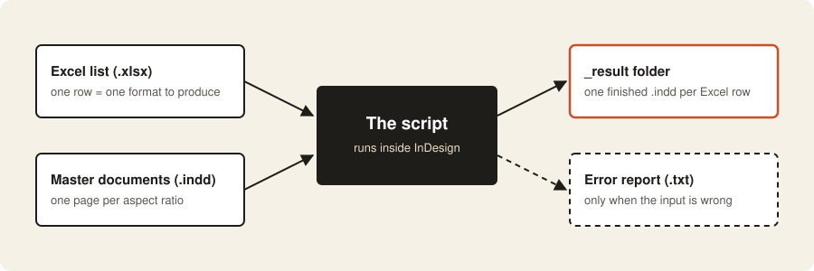
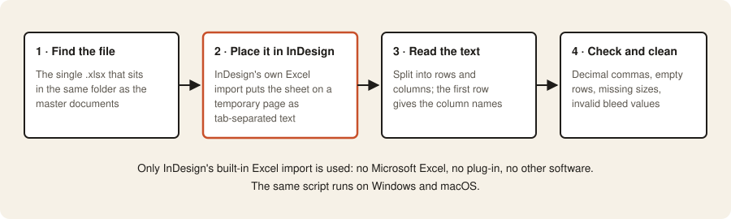
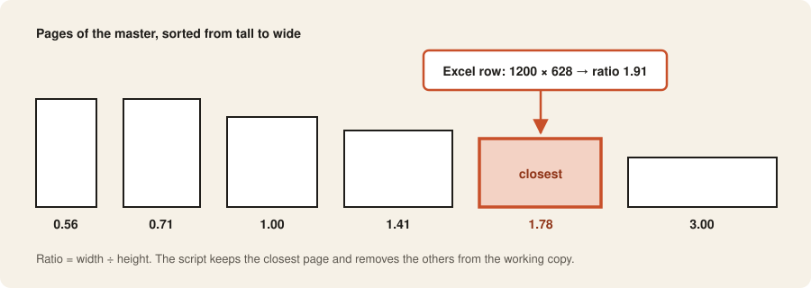
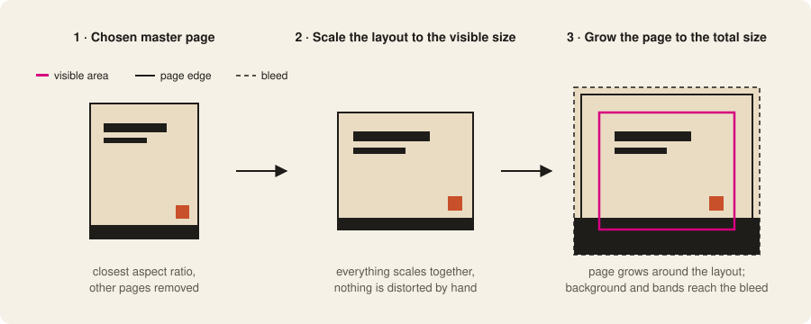
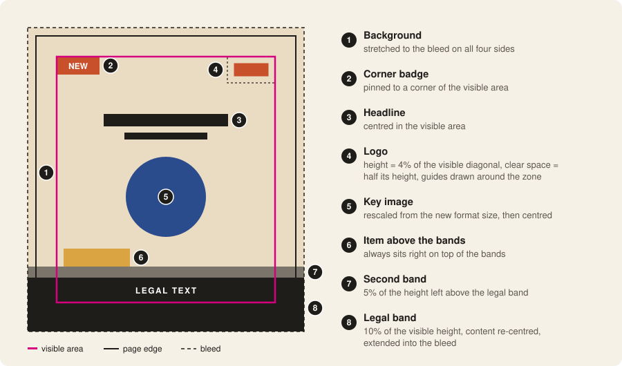
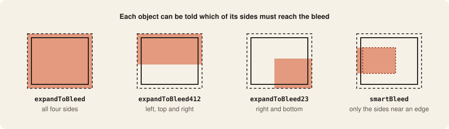

# InDesign Batch Resize

An ExtendScript (JavaScript) tool for Adobe InDesign that turns one key visual into any number of
formats, driven by an Excel file.

**Case study with diagrams: [resize.magic.re](https://resize.magic.re/)**

I wrote the first version in **2020** at Hogarth, on my own initiative — nobody had asked for it, and
nobody on the team had automated this work before. My colleagues adopted it and **the team used it in
production for over four years**. I have kept developing it ever since; this repository keeps every
version, from `v01` to `v23`.

In advertising, a campaign's key visual has to be delivered in dozens or hundreds of sizes (posters,
POS materials, press ads, banners). Doing this by hand takes from 30 minutes to several hours per
format. With the script, a format needs about **5 minutes of human attention**, mostly for a final check.

## In one picture

You give the script two things: a list of sizes in Excel and one or more master layouts. You get back
one finished, correctly built InDesign file for every row of the list. Everything in between is done
by the script, with no clicks.

## A few words, if you do not use InDesign

| Word | What it means here |
|---|---|
| **Key visual** | The approved design of a campaign: image, headline, logo, legal text. |
| **Format** | One size the design must be delivered in, e.g. an A3 poster or a 4 × 3 m billboard. |
| **Master document** | An InDesign file that holds the key visual laid out several times, once for each page shape (tall, square, wide). |
| **Total size / visible size** | The printed piece is often bigger than the part people actually see (the rest is hidden by a frame or a holder). Both sizes come from the client. |
| **Bleed** | A few extra millimetres printed beyond the cut line, so no white edge appears after trimming. |
| **Script label** | An invisible name tag on an object. The script reads it to know how that object must behave. |

## What the script does, step by step

The current version (`v23`) performs the operations below for every run. Done by hand, each of them
is a separate set of clicks, menus and typed numbers, and each is a chance to make a mistake.

### 1. It reads the Excel file by itself

InDesign scripts have no built-in way to open an Excel file. The usual workarounds need Microsoft
Excel installed, a plug-in, or a manual export to CSV. This script needs none of them: it uses
**InDesign's own Excel import**.

1. Takes the folder of the document you have open as the working folder.
2. Looks for the Excel file in that folder; stops with a clear message if there is none or more than one.
3. Creates a temporary document, places the first sheet of the Excel file into it as plain
   tab-separated text, reads the text, then closes the temporary document without saving.
4. Splits the text into rows and columns; keeps the first row as column names for the settings dialog.

The result: one `.xlsx` file next to the masters is all the script needs, on Windows and on macOS.

### 2. It checks the data before touching any layout

5. Skips empty rows.
6. Trims spaces and accepts both decimal comma and decimal point (`59,4` and `59.4`).
7. Checks that every total width and height is a real number.
8. Treats the visible size as optional: if it is missing, the visible area is the whole page.
9. Treats the bleed as optional: if it is missing, the bleed of the master is kept.
10. If the visible and total sizes were typed in the wrong columns, it swaps them.
11. Collects the master files named in the list and checks that each one exists.
12. Opens every master in the background and checks that the legal-text frames are built correctly.
13. If anything is wrong, it writes an **error report** (a text file with the Excel line and column
    of each problem) and stops before producing a single file.

Expected columns: `NR`, `TPOSM`, `material`, `WIDTH (VISIBLE)`, `HEIGHT (VISIBLE)`, `WIDTH (TOTAL)`,
`HEIGHT (TOTAL)`, `KV` (master file), `unit`, `bleed`, `Campaign name`, `final name`.

### 3. It asks how the files should be named

One dialog, shown once per run:

14. **Numbering**: automatic with a chosen start number (padded with zeros: `001`, `002`…), taken from
    the Excel list, or none.
15. **File name**: either composed from any Excel columns, in any order (move up / move down,
    include / exclude), or taken ready-made from one column.
16. Optional custom text, a chosen separator, and the bleed added at the end (e.g. `5mmbleed`).
17. A **live preview** of the first file name.
18. Colour of the rectangle that marks the visible area (CMYK values, optional fill and opacity), and
    whether that layer is shown, hidden or not created at all.
19. What happens to the page margins: equal to the visible area, kept from the master, or scaled with
    the page.
20. Checks the names before starting: empty names are refused, duplicate names trigger a warning
    because files would overwrite each other. Characters that are not allowed in file names are replaced.
21. Remembers the naming choices for the next run.

### 4. It picks the right page for each format

22. Sorts the pages of every master from tall to wide and saves the master.
23. For each Excel row, computes the shape of the requested format (width ÷ height).
24. Chooses the master page whose shape is the closest and deletes the other pages from the working copy.

A tall poster therefore starts from the tall layout and a wide banner from the wide layout, so the
design never has to be stretched into a shape it was not drawn for.

### 5. It rebuilds the page at the new size

25. Opens the master hidden (nothing flickers on screen) and unlocks all layers.
26. Sets the measurement units of the document from the Excel row: mm, cm, px or inch.
27. Scales the whole layout to the **visible** size, so all elements keep their proportions.
28. Grows the page from its centre to the **total** size, without moving the layout.
29. Sets the bleed from Excel, or keeps the bleed of the master.
30. Sets the page margins to the distance between the total and the visible size.
31. Adds two service layers on top of the document.
32. Draws a rectangle on the visible area, in the chosen colour, on its own layer.
33. Adds four guides on the edges of the visible area.
34. Writes an **info note** next to the page: visible size, total size, bleed, units and the master
    it came from, so whoever opens the file can check it at a glance.

### 6. It puts every element where the brand rules say

Scaling alone is not enough: a logo must not grow with the poster, a legal text must always take the
same share of the page, a background must reach the bleed. Each object in the master carries a script
label, and the script applies the matching rule after the resize. There are **more than 30 label
types**, and one object can combine several (`label1+label2`).

35. Resets the scaling of every object, so later measurements are correct.
36. **Legal band**: placed at the bottom of the visible area with a height of 10% of the visible
    height, its content re-centred (and optionally resized to a share of the band), then extended
    sideways and downwards into the bleed.
37. **Second information band**: 5% of the height that remains above the legal band, full width,
    plus a separator line between the two.
38. **Logo**, in any of the four corners of the visible area: height equal to 4% of the diagonal of
    the visible area, clear space equal to half the logo height, and guides drawn around the logo and
    its protected zone.
39. **Key image**: rescaled from the new format (one rule for tall formats, another for wide ones),
    centred, with a guide through its middle.
40. **Items above the bands**: moved so they always sit right on top of the legal bands, optionally
    pinned to the left or right corner.
41. **Page alignment**: top, bottom, left or right edge of the page.
42. **Visible-area alignment**: top, left, right, top-left corner, top-right corner, horizontal centre.
43. **Alignment to another object**: applied last, after that object has reached its final place.
44. **Headline frame**: stretched to the right edge of the visible area, text centred inside it.
45. **Fill the visible area**: the object takes exactly the size of the visible rectangle.
46. **Expand to bleed**, on all four sides or on any combination of sides:

47. **Smart bleed**: the script measures the picture inside the frame and extends only the sides that
    are already at, or within 5% of, a page edge.

### 7. It saves and moves on

48. Applies the chosen margin option (visible area, master margins, or scaled margins).
49. Locks the layers again and shows or hides the visible-area layer.
50. Creates the `_result` folder if it does not exist.
51. Saves the page as a new `.indd` file with the composed name and closes it.
52. Updates a progress window with the file name, the master in use and the counter.
53. Repeats for the next row, then reports that the job is done.

**That is roughly fifty operations per run, and about twenty-five of them repeated for every single
format.** For a list of 100 formats, the script performs a few thousand precise steps that a designer
would otherwise do by hand.

### The labels palette

`Add_Labels_for_resizing` is a companion palette that sets these labels with buttons laid out like
an InDesign page, so designers do not have to type them.

## History

| Year | Versions | What changed |
|---|---|---|
| 2020 | v01 – v09b | First working version: reads a tab-delimited text file, picks the master page by ratio, resizes and repositions. Written by hand, learning from the InDesign scripting reference and forums. |
| 2023 | v10a – v11 | Brand-specific rules for legal bands and logos. |
| 2024 | v11 – v12 multi-masters | Several master documents in one run, reads Excel directly, runs on Windows and macOS. |
| 2025 | v14 – v15a | Units (mm, cm, px, inch), composed file names, error report. |
| 2026 | v16 – v23 | Settings dialog that remembers naming options, configurable Excel columns, new label types, labels palette. From v17 on I refactor and extend the code with the help of an AI assistant; the logic and the rules come from six years of using it in production. |

The early versions are kept on purpose: they show how the code grew from one long procedural file
into functions with a configuration block, a dialog and error handling.

## Files

- `2020/` … `2026/` — one folder per year, one file per version
- `2026/Redimensionari_multiMasters_v23.jsx` — current version
- `2026/Add_Labels_for_resizing v4.jsx` — labels palette
- `2026/Redimensionari_template.xlsx` — Excel template with the expected header
- `docs/` — the sketches used in this page

## Usage

1. Copy the current script and the labels palette into the InDesign Scripts Panel folder.
2. Prepare the master document(s) and label the objects.
3. Fill in the Excel template and save it next to the masters.
4. Open a master and run the script.

## License

Published for portfolio and demonstration purposes. Please ask before reusing the code.

© Dan Ichimescu
